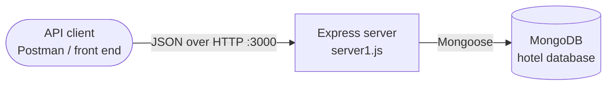

# Node Hotel (Restaurant Application): High-Level Design

A REST API for a restaurant: manage staff (chefs, waiters, managers) and menu items with full CRUD, built with Express and MongoDB. For code-level detail see the [Low-Level Design](lld.md).

## 1. Context

## 2. Resources

| Resource | Operations |
|---|---|
| Person (staff) | Create, list all, list by work type, update, delete |
| Menu item | Create, list, update, delete |

## 3. Tech

| Item | Choice |
|---|---|
| Server | Node.js, Express, body-parser |
| Database | MongoDB with Mongoose schemas |
| Connection | `mongodb://localhost:27017/hotel` |
