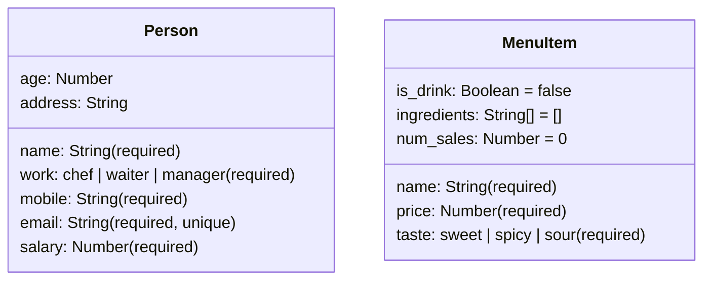
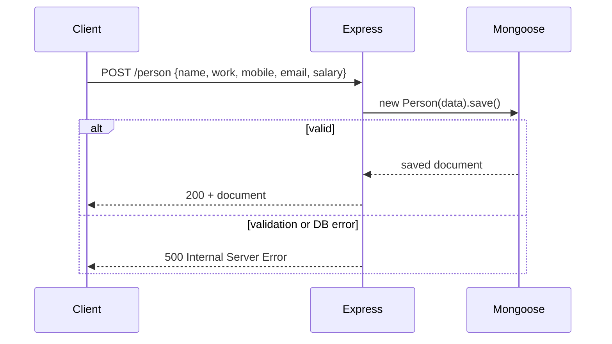

# Node Hotel (Restaurant Application): Low-Level Design

For the big picture see the [High-Level Design](hld.md).

## 1. Models

## 2. Routes

| Method | Route | Behavior |
|---|---|---|
| GET | `/` | "Welcome to our hotel" |
| POST | `/person` | Create a person |
| GET | `/person` | List all people |
| GET | `/person/:work` | List by `chef`, `waiter` or `manager` (404 otherwise) |
| PUT | `/person/:id` | Update with validators |
| DELETE | `/person/:id` | Delete |
| POST | `/menu` | Create a menu item |
| GET | `/menu` | List menu items |
| PUT | `/menu/:id` | Update with validators |
| DELETE | `/menu/:id` | Delete |

## 3. Request flow

## 4. Known issues

| Issue | Effect | Fix |
|---|---|---|
| `server1.js` never imports `MenuItem` | Every `/menu` route fails | `const MenuItem = require('./models/MenuItem');` |
| Successful `PUT` sends no response | Update requests hang | `res.status(200).json(response)` after the not-found check |
| `findByIdAndRemove` | Removed in Mongoose 8 | Use `findByIdAndDelete` |
| Two Person schemas (`person.js` and `models/Person.js`) | Confusing | Keep only `models/Person.js` |
